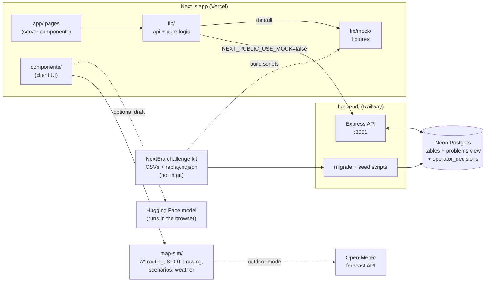

# Watchdog architecture

How Watchdog is built, for the people working on it and for judges who want to look under the hood. For what the app does and how to run it, start with the [README](README.md).

## System overview



Three deployable or runnable pieces live in one repository:

| Piece | Folder | Stack | Hosted on |
|---|---|---|---|
| Web app | repo root (`app/`, `components/`, `lib/`) | Next.js 15 (App Router), React 19, TypeScript, Tailwind CSS v4 | Vercel |
| API | `backend/` | Node 20+, Express 5, `pg` | Railway, service `api` |
| Map & simulation engine | `map-sim/` | Dependency-free TypeScript, Canvas 2D | Imported by the web app; also runs standalone in its own sandbox |

The database is Neon Postgres. The web app never talks to the database directly: only the API does.

### Two data modes

`lib/api.ts` is the single place the web app gets data from. Every page calls its helpers (`getMissions`, `getMission`, `getAsset`, `getInsights`, `setDecision`), never `fetch` or a CSV.

- **Mock mode** (default, and what CI builds): helpers return the JSON fixtures in `lib/mock/`, which were generated from the kit CSVs and cover all 27 missions, 20 assets and the Insights aggregates. Operator decisions live in React state only. A banner in `app/layout.tsx` says so.
- **API mode**: set `NEXT_PUBLIC_USE_MOCK=false` and `NEXT_PUBLIC_API_BASE` (see `.env.example`). The app has no `/api` routes of its own, so the base URL is required. Both variables are compiled into the browser bundle at build time: they must never hold a secret, and changing them needs a restart or rebuild.

Both modes return the same shapes, defined once in `contracts/types.ts` (`lib/types.ts` re-exports it).

### Repository layout

| Path | What lives there |
|---|---|
| `app/` | Routes: `/live`, `/missions`, `/missions/[id]`, `/assets/[id]`, `/insights`; `/` redirects to `/live`. Also the shell layout, error, loading and 404 pages, and design tokens in `globals.css`. |
| `components/` | UI by screen (`live/`, `missions/`, `report/`, `asset/`, `insights/`), the shared map (`map/FacilityMap.tsx`), app shell (`shell/`) and design-system pieces (`ui/`). |
| `lib/` | Data access (`api.ts`), pure functions that derive numbers and wording for each screen, labels (`format.ts`), static reference tables, fixtures, and the AI summary pipeline. Most files have a `*.test.ts` next to them. |
| `contracts/` | The shared API contract: `types.ts`, `endpoints.md`, and the map component's props (`facility-map-props.ts`). |
| `backend/` | Express API, SQL, migrate and seed scripts. Has its own [README](backend/README.md). |
| `map-sim/` | Map & Simulation engine, data, tools and tests. Has its own [README](map-sim/README.md). |
| `AI/Data Analytics/` | Standalone mission-risk analysis in Python. |
| `scripts/` | Fixture builders and fixture checks. |
| `audit/` | `final-check.py` (cross-checks the running API and fixtures against the kit CSVs) and dated review snapshots from October 10. |
| `public/` | SVGs exported from Figma (`figma/`) and NextEra's sample inspection photos (`inspections/`). |
| `.github/workflows/ci.yml` | CI for the web app and the backend. |

The challenge kit folders, `FRONTEND_PLAN.md` and `project_plan_kh26.pdf` are gitignored on purpose: the kit is NextEra's material and stays local.

---

## Design & Frontend

**Owner:** Jair Garcia (@jbear05).

### Visual system

- The design source of truth is the team Figma file (Live Mission, Mission Report, Insights and Asset Detail frames). The visual direction is a cartoon garden, "bloom vs blight": cream background, sticker panels with thick dark-green outlines, a pink flower for a passed step and a lime spore for a failed one.
- Tokens live in `app/globals.css` under a Tailwind v4 `@theme` block, using the same names as the Figma variables (colours, radii, the `type-*` text styles and the `sticker` utility). Fonts load through `next/font`: Fredoka for headings, Nunito for body text and IBM Plex Mono for IDs and numbers.
- Icons and glyphs are SVGs exported from Figma into `public/figma/`; general UI icons come from `lucide-react`.
- `components/ui/` holds the reusable pieces: `Button`, `SeverityBadge`, `StatusBadge`, `StatTile`, `EmptyState`, `Glyph`.

### Screens

| Route | Entry | What drives it |
|---|---|---|
| `/live?mission=M014` | `components/live/LiveMission.tsx` | A reconstructed replay (below), the shared map, the right rail (status, attention queue, event feed) and the replay bar. Query parameters open it paused (`at=02:15:00`), with what-ifs on (`heat=16`, `cold=55`, `obstacle=1`) or in outdoor mode (`outdoor=1&place=…`, `wx=storm` for a demo day). |
| `/missions` | `components/missions/MissionIndex.tsx` | Search, filters and sort from `lib/missions.ts`. |
| `/missions/[id]` | `components/report/*` | Headline, facts strip, route vine, ranked problem list with decision buttons, and the mission brief (AI draft). Numbers and sentences come from `lib/report.ts`. |
| `/assets/[id]` | `components/asset/*` | Reading history, past problems, failed steps and a sample photo, from `lib/asset.ts`. |
| `/insights` | `components/insights/*` | Charts and "so what" sentences from `lib/insights.ts`, plus the map in heatmap mode. |

Pages are server components that fetch through `lib/api.ts` and hand plain data to client components.

### Key frontend decisions

- **One clock on Live.** `components/live/useReplay.ts` owns the mission clock (play, pause, 1×/10×/60×, seek). The map, the right rail and the replay bar all derive their state from it through pure functions in `lib/replay.ts`, so they can never disagree.
- **Reconstructed replay.** Live rebuilds the walk from the mission's recorded actions, timestamps and findings rather than streaming the backend's SSE endpoint. That works for all 27 missions, works in mock mode, and lets findings appear in the attention queue when their step finishes. The kit's original `replay.ndjson` covers only M001–M023, and the page says when a mission has no original log.
- **Review states are defined once.** `lib/report.ts` documents them: a recorded finding never changes; a finding is awaiting review when the data flags it (`operator_review_required`, true for exactly the HIGH and CRITICAL rows) and no decision is saved; a saved decision (dispatch, watch or dismiss) records a choice, not a repair. `components/report/useDecisions.ts` applies decisions optimistically and posts them in API mode.
- **Pure logic, tested.** Anything that turns data into a number or a sentence lives in `lib/` as a pure function with a Vitest test next to it. Components only lay things out.
- **Accessibility.** A skip link to the main content, keyboard-operable controls, and ARIA labels on icon buttons and charts.

---

## Map & Simulation

**Owner:** @IliasCoder. Full details in [map-sim/README.md](map-sim/README.md).

### The engine (`map-sim/`)

- **`data/map.json`** is the single source of truth for the map: the pixel position of each of the 15 waypoint pins on the kit's floor plan (`public/floorplan.png`, 1095×595, two floors), a walkable grid of 5 px cells (219×119), and the one staircase that links the floors. The `x`/`y` columns in `locations.csv` don't line up with the image, so they are not used.
- **`src/sim/astar.ts`**: `NavGrid.route(from, to)` returns the polyline SPOT walks, around walls and through doors, using the stairs only when the floor changes.
- **`src/sim/spot.ts`**: the animated robot dog drawn with Canvas 2D (no images). `SpotAnimator` keeps heading and leg phase between frames; modes are idle, walk, inspect (scan cone) and fail.
- **`src/sim/scenario.ts`**: what-if scenarios (heat wave, obstacle at the dock) and alert thresholds. Every alert is tagged DATA (from the kit) or SIMULATED (only exists because a scenario is on).
- **`src/sim/health.ts`**: a component health score built from the data, and a simulated remaining-life estimate.
- **`src/sim/replay.ts`**: a mission replay without drawing (`MissionRun`, `AlertFeed`).
- **`src/sim/weather.ts`**: today's forecast from Open-Meteo (free, no key; only a city's coordinates are sent) and a safe / not safe verdict for outdoor work.
- **`tools/`**: `build_grid.py` builds the grid from traced rectangles, `grid-editor.html` lets you paint cells by hand, `build_missions.py` rebuilds `data/missions.json` from the kit CSVs.

The engine has no UI framework dependency. `npm test` in `map-sim/` (Node 22.6+) routes all 210 stop-to-stop pairs, checks that no route touches a blocked cell and that each matches an independent shortest-path search, and covers SPOT motion, scenarios, health, replay and weather. `npm run sandbox` serves a standalone page to try it.

### How the web app uses it

- `components/map/FacilityMap.tsx` wraps the engine in a React component with two modes, live and heatmap (props in `contracts/facility-map-props.ts`). It imports `map-sim/` directly through the `@/` path alias and does not modify it.
- It can draw on the kit's floor plan photo (the default) or on the Figma cartoon plan (`base="cartoon"`, 872×474). The cartoon is the same plan traced, so routes move across with one scale-and-shift per floor and land within 5 px of each pin.
- `lib/scenarios.ts` connects the what-ifs to Live (heat wave, the mirror-image cold snap, obstacle detour, component-life alerts). `lib/weather.ts` connects outdoor mode, with editable demo weather clearly tagged as a what-if.
- SPOT's starting point isn't in the data; it is assumed to be the Main Entrance (WP01), set in `lib/replay.ts`.

---

## Backend & Database

**Owner:** @FredoC7. Setup, endpoints, deployment and troubleshooting are in [backend/README.md](backend/README.md).

### Database (Postgres on Neon)

`backend/sql/schema.sql` creates seven tables that mirror the kit, plus one for the app's own state:

| Table | Rows after seed | Notes |
|---|---:|---|
| `locations` | 15 | The waypoints WP01–WP15. |
| `assets` | 20 | Equipment, with criticality. |
| `missions` | 27 | Status, scenario, configuration version (V1 or V2), battery at start and end. |
| `actions` | 270 | Each step of a mission: type, location, asset, status, failure type. |
| `readings` | 220 | Measurements. 56 are localization confidence, which is robot telemetry rather than equipment health. |
| `anomalies` | 40 | Findings with severity and `operator_review_required`. |
| `replay_events` | 500 | The kit's `replay.ndjson` (M001–M023). |
| `operator_decisions` | 0 | Written by the app. Every decision adds a row; history is kept. |

`backend/sql/002_create_problems_view.sql` defines the `problems` view that the API reads findings from. It joins each anomaly to its action, location, asset and mission and adds:

- `priority` = severity (1–4) × asset criticality (1–4), which orders the problem lists;
- `hidden_in_completed`, true when a HIGH or CRITICAL finding sits inside a mission marked COMPLETED;
- the latest operator decision, if any.

### API (`backend/src/`)

- Express 5 with open CORS, so any frontend origin can call it. Routes are split by resource in `src/routes/`: missions, assets, locations, insights, problems (the decision POST) and replay (server-sent events at 1×, 10× or 60×).
- `src/db/pool.js` sets two `pg` type parsers: `TIMESTAMP` comes back as the raw plant-local string (no time-zone shift) and `NUMERIC` as a JavaScript number.
- Asset endpoints leave localization readings out, so they are never charted as equipment health.
- Insights aggregates are computed in SQL in `src/routes/insights.js`. Every rate is returned as a `RateStat` (total, succeeded, percent) so the UI can always show its denominator.

### Scripts and hosting

- `npm run migrate` creates the tables if `missions` doesn't exist yet and replaces the `problems` view; it is safe to re-run.
- `npm run seed -- <kit>/02_DATA` loads every CSV and the replay log in one transaction with `ON CONFLICT DO NOTHING`. It never touches `operator_decisions`.
- The API runs as a long-lived Node process (it holds SSE connections), so it is hosted on Railway rather than as a Vercel function. Railway runs `npm start` and only needs `DATABASE_URL`.

---

## Data & AI

**Owner:** Rayan Hannani for the mission-risk analysis; the AI mission brief and the Insights analysis were built with the frontend.

### What the data says

The kit is synthetic: 27 missions over 15 waypoints and 20 assets, with 270 steps, 220 readings and 40 findings. The analysis the app is built around:

- **Hidden problems.** A mission marked COMPLETED can still have failed steps and serious findings. Missions surfaces these as "completed with issues" and the API flags them through `hidden_in_completed`.
- **Configuration V1 vs V2.** Insights compares mission and step success by configuration, and within each inspection type so the comparison isn't skewed by a different mix of steps. These are observed associations, not proven causes.
- **Where and why steps fail.** Failure rates by waypoint (with a minimum sample before a stop is ranked), by inspection type, and by failure cause; plus a heatmap of where findings cluster and the assets with repeat findings.
- **Battery.** Step success by battery band. The 20% "dock before this" line is a suggested heuristic from a small bucket (11 low-battery steps) and is labelled that way.

Every Insights number is shown with its denominator, and groups under 20 steps are marked as a small sample. The thresholds are named constants in `lib/insights.ts`.

### AI mission brief

The Mission Report can draft a short prose summary with `Falconsai/text_summarization` (Apache-2.0) running in the browser through Transformers.js (`@huggingface/transformers`). There is no API key and no server; the first draft downloads the model from Hugging Face and later drafts use the browser cache.

The pipeline lives in `lib/`:

1. `mission-summary-input.ts` builds the model input from the mission's records, most important facts first, and also builds the authoritative record summary that is always shown.
2. `mission-summarizer.ts` loads the model, generates the draft and tidies it (restores record IDs, capitalises sentences, drops a cut-off tail; it never adds words).
3. `mission-summary-grounding.ts` rejects any draft containing a number or record ID that isn't in that mission's input. Written-out numbers and fractions are rejected too.

The grounding check catches invented numbers but cannot tell whether a number is attached to the right fact, so the draft is always shown as a draft, under the record summary and never replacing it. If the model fails or the draft is rejected, the record summary is unaffected.

### Mission risk analysis

`AI/Data Analytics/step1_mission_risk.py` scores each mission from the kit CSVs and writes `mission_summary_step1.csv`:

```
risk_score = 8 × failed steps + 12 × severe findings + 6 × findings needing review
           + 2 × questionable readings + battery drop ÷ 10
```

It also marks `hidden_risk` for COMPLETED missions with any of those issues, and names the riskiest location and asset. Run it with `python "AI/Data Analytics/step1_mission_risk.py" --data-dir "SPOT_KnightHacks_Challenge_Kit Part One/02_DATA"` (or set `SPOT_DATA_DIR`). It is standalone: the web app doesn't read its output.

### Fixtures and data checks

The mock fixtures are generated from the kit, never edited by hand. Run from the repo root with the kit folder in place:

```bash
node scripts/build-insights-mock.mjs "SPOT_KnightHacks_Challenge_Kit Part One/02_DATA"    # insights.json, missions.json
python lib/mock/build_assets.py "SPOT_KnightHacks_Challenge_Kit Part One/02_DATA"         # assets.json
python lib/mock/build_missions.py "SPOT_KnightHacks_Challenge_Kit Part One/02_DATA"       # missions-detail.json
python scripts/check-mission-fixture.py "SPOT_KnightHacks_Challenge_Kit Part One/02_DATA" # M014 fixture vs the CSVs
python audit/final-check.py   # recomputes Insights from the CSVs and compares the running API (localhost:3001) and fixtures
```

---

## Testing and CI

| Command | Where | Checks |
|---|---|---|
| `npm run lint` | root | ESLint (Next.js config; `backend/` is ignored because it is CommonJS). |
| `npx tsc --noEmit` | root | Types, including `map-sim/` sources the app imports. |
| `npm test` | root | Vitest: derived numbers, filters, replay sync, review states, Insights wording, summary input and grounding, API helpers, Live components. |
| `npm run build` | root | Production build. Stop `npm run dev` first; both write to `.next/`. |
| `npm test` | `map-sim/` | Node's built-in test runner (Node 22.6+): routing, SPOT motion, scenarios, health, replay, weather. |

GitHub Actions (`.github/workflows/ci.yml`) runs on every push to `main` and every pull request. The frontend job runs lint, type check, tests and build in mock mode on Node 22. The backend job installs dependencies and syntax-checks every file (CI has no database). Vercel builds a preview for each pull request.

## Deployment

- **Web app (Vercel).** `vercel.json` runs `npm ci` and `npm run build`. Production and Preview set `NEXT_PUBLIC_USE_MOCK=false` and `NEXT_PUBLIC_API_BASE` to the Railway API, so deployments read live data; without them a deployment falls back to mock mode and shows the banner.
- **API (Railway).** Deployed from `backend/`; steps in [backend/README.md](backend/README.md#deployment).
- **Database (Neon).** Already migrated and seeded. Decisions saved on the hosted site are written there and shared by everyone using it.

## Known limits

- All data is synthetic. Nothing here has been validated against a real plant or robot.
- The kit has no thresholds, weather or room temperature. Every limit used by the what-ifs and alerts says where it comes from, and simulated alerts are tagged as such.
- A saved decision records the operator's choice; it doesn't notify anyone or open a work order.
- There is no login. Anyone with the hosted link can save decisions to the shared database.
